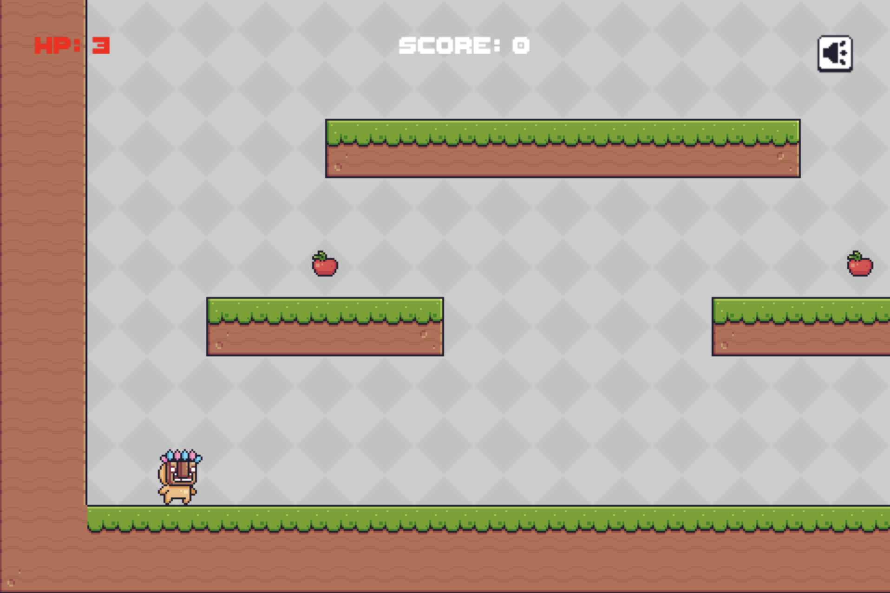

# Selene Tutorial (English)

This tutorial helps you quickly experience the Selene game engine.

## Understanding Selene

Selene is an experimental engine that encourages users to unleash creativity based on fundamental programming building blocks.

Selene has the following characteristics:

- Free and open source
- Simple: streamlined core code, implemented in MoonBit (platform backends provided by backend modules)
- Modular: import only what you need, select backend through wrapper packages
- Efficient: benefits from MoonBit performance and ECS architecture

Selene already supports 2D/3D rendering, input, UI, physics, and Tiled/LDtk integration, and contributions are always welcome.

## Running the Example

Make sure you have installed the [MoonBit toolchain](https://www.moonbitlang.com/download/) and learned basic usage.

Clone this repository:

```shell
git clone https://github.com/moonbit-community/selene.git
```

From the repository root, build the web sample:

```shell
moon update
moon -C examples-web build ./pixeladventure/web --target js --release
```

Run with any web server, for example Python:

```shell
python3 -m http.server 8000
```

After startup, open `http://localhost:8000/examples/pixeladventure/` in your browser.

Next, try changing a few source values (viewport size, zoom, FPS), then rebuild and rerun. This gives a quick practical understanding of both the sample and the engine.

## Making Your First Game

This chapter shows how to build a complete platformer-style game with Selene and learn the core workflow through real implementation steps.

### Example Game Showcase

The game we will build looks like this:



In the following process, we will build:

- Green grass tiles
- A controllable character
- A camera that follows the player
- Collectible apples
- A score display
- A volume toggle button

Players use arrow keys to move and jump. Collecting apples increases score. The volume button toggles game audio.

### Project Creation and Configuration

First install MoonBit CLI. If you use VS Code, install the MoonBit extension for better diagnostics and navigation.

After creating a new project with `moon new`, use a structure similar to `examples/pixeladventure`:

- `pixeladventure`: shared gameplay package, level setup, and asset references
- `pixeladventure/web`: web wrapper package (selects webgpu backend by overrides)

### Asset Preparation

The image and audio assets can be downloaded from:

- [Image assets](https://pixelfrog-assets.itch.io/pixel-adventure-1)
- [Audio assets](https://brackeysgames.itch.io/brackeys-platformer-bundle)

Place assets under paths such as `assets/pixeladventure/...`.

The level is defined in `level.mbt` and `level_data.mbt` beside the gameplay code.

### Engine Dependency Installation

Add Selene dependencies:

```bash
moon add Milky2018/selene
moon add Milky2018/selene_webgpu
```

Core gameplay package imports are module-based. Example from `examples/pixeladventure/moon.pkg`:

```moonbit
import {
  "Milky2018/selene/app",
  "Milky2018/selene/animation",
  "Milky2018/selene/asset",
  "Milky2018/selene/audio",
  "Milky2018/selene/ecs",
  "Milky2018/selene/event",
  "Milky2018/selene/inputs",
  "Milky2018/selene/math",
  "Milky2018/selene/physics2d",
  "Milky2018/selene/plugins",
  "Milky2018/selene/sprite",
  "Milky2018/selene/time",
  "Milky2018/selene/transform",
  "Milky2018/selene/ui",
  "moonbitlang/core/json",
}
```

Web wrapper example (`examples-web/pixeladventure/web/moon.pkg`):

```moonbit
import {
  "Milky2018/selene-examples/pixeladventure" @pixeladventure_game,
}

supported_targets = "js"

options(
  "is-main": true,
  overrides: [
    "Milky2018/selene_webgpu/platform_window",
    "Milky2018/selene_webgpu/platform_input",
    "Milky2018/selene_webgpu/platform_render",
    "Milky2018/selene_webgpu/platform_audio",
    "Milky2018/selene_webgpu/platform_asset_io",
  ],
  targets: { "main.mbt": [ "js" ] },
)
```

Web wrapper `main.mbt`:

```moonbit
fn main {
  @pixeladventure_game.run()
}
```

The App object is the runtime entrypoint. Example app bootstrap:

```moonbit
pub fn run() -> Unit {
  @app.App()
  .with_viewport_width(480.0)
  .with_viewport_height(320.0)
  .with_image_smooth(false)
  .with_zoom(2.0)
  .add_plugin(@plugins.default_plugin)
  .add_exclusive_system(Startup, game_start)
  .add_system(Update, @ecs.args2(player_input_system))
  .add_system(FixedPreUpdate, @ecs.args4(player_controller_system))
  .add_system(Update, @ecs.args4(trigger_system))
  .add_system(Update, @ecs.args2(pixeladventure_camera_follow_system))
  .add_system(FixedPostUpdate, @ecs.args4(player_bird_contact_system))
  .add_system(FixedPostUpdate, @ecs.args4(bird_patrol_system))
  .add_system(PostUpdate, volume_button_system)
  .add_system(PostUpdate, @ecs.args4(hud_sync_system))
  .run()
}
```

Systems are executed by schedule, and each system owns a specific responsibility (input, collision, UI, rendering, etc).

Browser rendering follows the display refresh rate by default. Use `with_max_fps(60)` for an explicit frame limit and `with_fixed_hz(60)` to configure simulation frequency independently. Pixel Adventure samples input each frame, buffers jump presses, and updates motion before each physics step.

### Game State Management

Pixel Adventure keeps one game session resource per World and attaches player
controllers to their entities.

```moonbit
#selene.resource
priv struct GameSession {
  player : @ecs.Entity
  camera : @ecs.Entity
  result_box : @ecs.Entity
  score_box : @ecs.Entity
  health_box : @ecs.Entity
  volume_button : @ecs.Entity
  mut score : Int32
  mut health : Int32
  mut volume_on : Bool
  mut result : GameResult?
  world_size : @math.Vec2
}

#selene.component
priv struct PlayerController {
  mut facing : Direction2
  mut state : PlayerState
  mut hurt_cooldown : Double
  mut pending_bounce_velocity_y : Double?
  animations : PlayerAnimationNodes
  mut active_animation : PlayerAnimationKey?
}
```

Startup cleans up the previous run, loads the level, and inserts the new
`GameSession` with `world.insert_resource(...)`. Ordinary gameplay systems
receive their queries, optional `Res[GameSession]?`, Commands, and Time through
`argsN`. Movement and animation helpers use query rows directly; value
components are replaced through `query.set(entity, row)`. The camera and HUD
also use injected queries. Complete World access remains in Startup for scene
construction. The package applies the generation rule to `model.mbt`.

```moonbit
dev_build(rule: "selene_codegen", input: "model.mbt", output: "model.g.mbt")
formatter(ignore: ["model.g.mbt"])
```

Commit `model.g.mbt` alongside its source. See the [ECS guide](../selene-core/src/ecs/README.md#code-generation)
for the module rule and the standalone generator.

### Entities and Components

Pass the initial components to the World when spawning a player.

```moonbit
let world = @ecs.require_current_world()
let player = @ecs.commands(world).spawn((
  @transform.Spatial(@transform.Transform::from_xyz(100.0, 100.0, 0.0)),
  @physics2d.Velocity(@math.Vec2::zero()),
))
```

The scheduler writes both components into the final archetype together when it
applies the command. The returned handle is pending until then. Public creation
is deferred during both setup and queries.

### Player Character Implementation

Player usually has multiple animation states (idle/run/jump/fall). Idle example:

```moonbit
let player_idle_layout = @sprite.register_texture_atlas_layout(
  @sprite.TextureAtlasLayout::from_grid(@math.Vec2(32.0, 32.0), 11, 1),
)
let player_idle_image = @asset.load_image(
  "assets/pixeladventure/Main Characters/Mask Dude/Idle (32x32).png",
)
```

`TextureAtlasLayout` describes where each frame lives in the atlas, while runtime playback updates `TextureAtlas.index`.

Build a clip/graph pair and attach an animation player with:

```moonbit
let sprite = @sprite.Sprite::from_atlas_image(
  player_idle_image,
  @sprite.TextureAtlas(player_idle_layout),
)
let clip = @animation.AnimationClip("player_idle")
let frame_keys : Array[@animation.ScalarKeyframe] = []
for index in 0..<11 {
  frame_keys.push({
    time: index.to_double() / 12.0,
    value: index.to_double(),
    in_tangent: None,
    out_tangent: None,
  })
}
clip.add_curve_to_target(
  @animation.AnimationTargetId("self"),
  @animation.VariableCurve::scalar(
    @animation.texture_atlas_index_field(),
    frame_keys,
    interpolation=@animation.ChannelInterpolation::Step,
  ),
)
let (graph, nodes) = @animation.AnimationGraph::from_clips([
  @animation.register_animation_clip_asset(clip),
])
let player_animation = @animation.AnimationPlayer()
ignore(player_animation.play(nodes[0], repeat=@animation.RepeatAnimation::Forever))
let player = @ecs.commands(world).spawn((
  @transform.Spatial(@transform.Transform::from_xyz(100.0, 100.0, 0.0)),
  @physics2d.Velocity(@math.Vec2::zero()),
  sprite,
  @animation.register_animation_graph_asset(graph),
  player_animation,
  @animation.AnimationTargetId("self"),
))
```

Input handling uses `@inputs`:

```moonbit
if @inputs.is_pressed(@inputs.ArrowLeft) {
  // move left
} else if @inputs.is_pressed(@inputs.ArrowRight) {
  // move right
}

if @inputs.is_just_pressed(@inputs.ArrowUp) && @physics2d.is_grounded(player) {
  // jump
}
```

`is_pressed` is continuous; `is_just_pressed` is edge-triggered.

### Obstacles and Collision

Configure collision groups, shape, and collider to block terrain penetration:

```moonbit
let terrain_collision_group = @physics2d.CollisionGroup()
let player_collision_group = @physics2d.CollisionGroup()

let shape = @physics2d.CollisionShape::Rect(
  size=@math.Vec2(24.0, 32.0),
  offset=@math.Vec2(4.0, 0.0),
)
let collider = @physics2d.Collider(
  @physics2d.CollisionFilter(player_collision_group, [terrain_collision_group]),
)
let player = @ecs.commands(world).spawn((
  @transform.Spatial(@transform.Transform::from_xyz(100.0, 100.0, 0.0)),
  @physics2d.Velocity(@math.Vec2::zero()),
  shape,
  collider,
))
```

Only allowed collision-filter pairs will interact.

### Level Loading

`level.mbt` spawns the player, apples, flag, and camera directly. Tile coordinates in `level_data.mbt` supply terrain sprites and merged row colliders.

### Camera

When world size is larger than viewport, move the camera entity each frame and clamp it into the level bounds:

```moonbit
let target_x = player_transform.translation.x + 16.0
let target_y = player_transform.translation.y + 16.0
let center_x = target_x.clamp(half_width, session.world_size.x - half_width)
let center_y = target_y.clamp(half_height, session.world_size.y - half_height)
@transform.set_local_transform(
  session.camera,
  @transform.Transform::from_xyz(center_x, center_y, 0.0),
)
```

### Areas and Audio

Apples should not block movement, but should trigger collection behavior. Add `Area` and detect contain state in system:

```moonbit
let area = @physics2d.Area(
  @physics2d.CollisionFilter(trigger_collision_group, [
    player_collision_group,
  ]),
)
let apple = @ecs.commands(world).spawn((spatial, sprite, shape, area, apple_tag))

fn map_trigger_system(_world : @ecs.World) -> Unit {
  for apple in apples.to_array() {
    if @physics2d.get_contains(apple).contains(session.player) {
      session.score += 10
      if session.volume_on {
        play_sfx(coin_sound, session.volume_on)
      }
      @ecs.commands(world).delete(apple)
    }
  }
}
```

Sound effects are sent as audio events:

```moonbit
fn play_sfx(sound : @audio.AudioHandle, enabled : Bool) -> Unit {
  if enabled {
    @audio.send_audio_event(sound, settings=@audio.PlaybackSettings::despawn())
  }
}
```

### User Interface

Current UI uses `@ui` component stores for text/buttons/images. Example score text:

```moonbit
fn spawn_score_box(world : @ecs.World) -> @ecs.Entity {
  @ecs.commands(world).spawn((
    @ui.Node::absolute(
      @math.Vec2(48.0, 16.0),
      size=@math.Vec2(432.0, 24.0),
    ),
    @ui.ZIndex(100),
    @ui.Text("Score: 0"),
    @ui.TextFont::from_css("20px ThaleahFat"),
  ))
}
```

Volume button click handling:

```moonbit
let ui_click_reader : @event.EventReader[@ui.UiClickEvent] = @event.EventReader()

fn volume_button_input_system(_world : @ecs.World) -> Unit {
  for event in @ui.click_event_bus.read(ui_click_reader) {
    guard event.entity == session.volume_button else { continue }
    session.volume_on = !session.volume_on
  }
}
```

### Build & Play

Build command:

```shell
moon build examples-web/pixeladventure/web --target js --release
cp _build/js/release/build/Milky2018/selene-examples-web/pixeladventure/web/web.js page/examples/pixeladventure/web.js
```

Then use `page/examples/pixeladventure/index.html`, which references:

```html
<script src="web.js" defer></script>
```

Run the local server from the repository root, serving the Pages directory:

```shell
python3 -m http.server --directory page 8000
```

Open `http://localhost:8000/examples/pixeladventure/` to play.

Complete source: [Selene Example](https://github.com/moonbit-community/selene/tree/main/examples/pixeladventure)

## Next Steps

Congratulations on completing your first Selene game. You now have the core workflow in place. Next, you can:

- Extend gameplay: add more levels, enemies, items, or mechanics
- Improve game feel: polish animation, audio, and visual feedback
- Contribute to the community: report issues or submit improvements on [GitHub](https://github.com/moonbit-community/selene)
- Build original projects: apply this architecture to your own game ideas

Selene can be used not only for games, but also for graphical interactive applications. Build something great with MoonBit and Selene.
